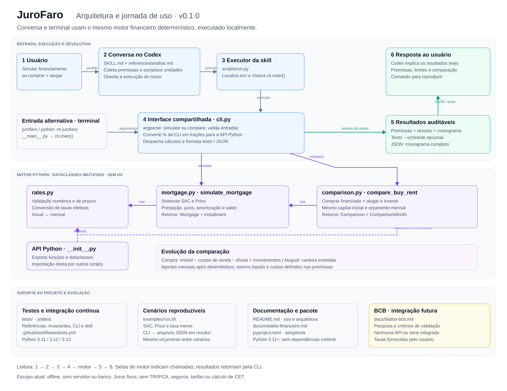

# JuroFaro

Inteligência independente de crédito, começando por financiamento imobiliário.
A versão **0.1.0** simula **SAC e Price** e compara o patrimônio de **comprar
financiado versus alugar e investir**. A skill do Codex e a CLI usam o mesmo
motor Python determinístico: o LLM coleta premissas e explica os resultados.

[](docs/arquitetura/jurofaro-arquitetura.svg)

[Ampliar diagrama](docs/arquitetura/jurofaro-arquitetura.svg) ·
[Editar no draw.io](docs/arquitetura/jurofaro-arquitetura.drawio)

## Começar pela conversa

Requer **Python 3.11+**, sem instalação de pacotes. Abra este repositório no
Codex CLI ou na extensão Codex do VS Code e inicie uma nova sessão para carregar
[a skill](.agents/skills/jurofaro/SKILL.md). Depois, peça:

```text
$jurofaro Simule SAC e Price para um imóvel de R$ 500 mil, entrada de
R$ 100 mil, prazo de 360 meses e juros efetivos de 12% ao ano.
```

A skill pergunta os dados essenciais ausentes, executa o motor e apresenta
premissas, resultados e um comando para reproduzir. Também compara comprar com
alugar e investir, considerando horizonte, custos e retorno líquido.

Veja no [guia de uso](docs/guia-de-uso.md) um exemplo completo de comparação,
a execução sem instalação e como disponibilizar a skill em outros projetos.

## Usar pelo terminal

Na raiz do repositório:

```bash
python3 -m venv .venv
source .venv/bin/activate
python -m pip install -e .
jurofaro simulate --property-price 500000 --down-payment 100000 \
  --annual-rate 12 --months 360 --system SAC
```

Exemplo fictício. Na CLI, `--annual-rate 12` significa **12% efetivos ao ano**.
Troque `SAC` por `PRICE` para mudar o sistema. Use `--schedule` para ver as
parcelas ou `--format json` para exportar premissas, resumo e cronograma completo.
Após instalar, `python -m jurofaro` também funciona.

O comando `jurofaro compare` compara as alternativas com o mesmo capital inicial
e orçamento mensal, investindo o excedente de cada uma. O horizonte pode ser
diferente do prazo do financiamento. Consulte os
[comandos, parâmetros e resultados de referência](docs/guia-de-uso.md#comprar-versus-alugar-e-investir).

## Desenvolver e conferir

Python 3.11+, sem dependências externas de execução ou testes, servidor, banco
de dados ou credenciais. A instalação usa setuptools.

```bash
python -m unittest discover -s tests -v
bash examples/run.sh
```

Os testes verificam referências manuais, invariantes, CLI e execução pela skill;
a CI cobre Python 3.11, 3.12 e 3.13. Os exemplos geram cenários JSON em `results/`.

Os motores ficam em `src/jurofaro/`: `rates.py` valida e converte taxas,
`mortgage.py` calcula SAC/Price e `comparison.py` calcula a evolução patrimonial.
Recebem números e devolvem dataclasses imutáveis, sem I/O. A API Python usa
**frações** (`0.12` = 12%); a CLI usa percentuais (`12` = 12%).

## Premissas e limites

O financiamento usa juros fixos, sem TR/IPCA, carência, seguros, tarifas,
amortizações extras ou renegociação; **não calcula CET**. A comparação usa custos
explícitos e valores nominais, sem descontar inflação ou modelar risco e tributos
individuais. O retorno informado deve ser líquido de custos e tributos.

Sem orçamento fixo, o modelo iguala os fluxos pelo maior desembolso de cada mês;
isso **não verifica capacidade de pagamento**. Percentuais opcionais começam em
zero. Resultados dependem das premissas e não constituem aprovação de crédito ou
recomendação personalizada. Não há integração com o BCB nesta versão.

- [Guia de uso: exemplos, parâmetros e API Python](docs/guia-de-uso.md)
- [Modelo financeiro: fórmulas, convenções e limites](docs/modelo-financeiro.md)
- [Dados do BCB: investigação e critérios para integração](docs/dados-bcb.md)
